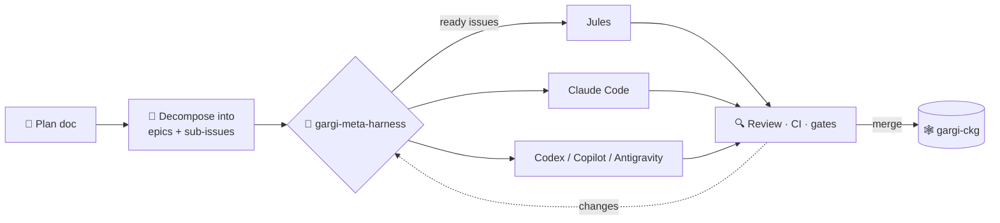

## Hi there, I'm Gishnu 👋

**I build AI systems that think in graphs.**
Knowledge graphs · GraphRAG · graph neural networks · agentic LLM apps · small language models

---

### 🪷 Gargi: where I build in the open

**[Gargi](https://github.com/gargi-indic)** ([gargi.io](https://gargi.io)) is my home for **open-source projects and Small Language Models (SLMs)**. The bet: small models can do real work when you give them the right structure, through computational knowledge graphs, durable orchestration, and agent harnesses that keep them on track. Indic languages are a first-class focus.

| Project | What it is | Stack |
| --- | --- | --- |
| 🧭 [**gargi-meta-harness**](https://github.com/gargi-indic/gargi-meta-harness) | A local conductor that drives a whole team of coding agents through playbooks you design | Python · FastAPI · React Flow |
| 🕸️ [**gargi-ckg**](https://github.com/gargi-indic/gargi-ckg) | Gargi's Computational Knowledge Graph: a pluggable, reactive graph engine for durable, event-driven DAG execution | Go · Temporal · gRPC |
| 🔤 [malayalam-gpt-zero-to-hero](https://github.com/gishnucodes/malayalam-gpt-zero-to-hero) | Building a Malayalam GPT from scratch, the start of my Indic SLM work | Python · PyTorch |

#### 🧭 gargi-meta-harness: one conductor, many agents

Give it a plan and it runs the build. The harness orchestrates **Jules, Claude Code, Codex, Copilot and Antigravity** behind a single interface, and you decide *how* a problem gets attacked.

- **GitHub is the state.** Issues, sub-issues, `blocked_by` links, labels, PRs and comments are the source of truth. Kill the daemon and it rebuilds itself from GitHub.
- **Playbooks you can draw.** Graphs of agent steps, LLM-judge reviews, CI and scope checks, loops and human gates, edited in a visual React Flow editor and stored as YAML.
- **Dependency-aware dispatch.** Every issue whose blockers are closed becomes *ready* and is picked up, with per-agent concurrency caps.
- **A localhost command center.** See the issue DAG and live runs, and work an inbox of decisions waiting on you.
- **Autonomy on a dial.** Each gate can be `human`, `auto`, or `auto_if: <expr>`, set per playbook.

#### 🕸️ gargi-ckg: a reactive graph engine

The computational backbone of Gargi. Graphs are defined in YAML or JSON. When a node's state changes it emits an event, and that event schedules the nodes downstream.

- **Durable by default.** Each graph run is a Temporal workflow and each node an activity, with retries, signals, queries and Saga-style compensation.
- **Pluggable state.** One `StateStore` interface with in-memory, Redis, PostgreSQL and Neo4j adapters.
- **Talk to it any way.** gRPC, REST, and live execution streams over SSE or WebSockets.
- **Clean architecture, enforced.** Public contracts live in `pkg/engine`. Domain packages never import infrastructure.

#### ♻️ The fun part: the harness builds the graph

gargi-ckg is being built issue by issue by AI agents, with an orchestrator assigning work, reviewing plans and PRs, and merging. The meta harness turns that workflow into a reusable, project-independent tool.

---

### 🔭 More things I've built

**Knowledge graphs & GraphRAG**
- [BlazeGraph](https://github.com/gishnucodes/BlazeGraph): the "SQLite of graph databases", an in-memory, pure-Java graph engine for embedded processing and fast analytics
- [GraphRAG-Document-Retriver](https://github.com/gishnucodes/GraphRAG-Document-Retriver): hybrid GraphRAG that ingests documents into a Neo4j knowledge graph and answers questions with Cypher retrieval plus vector search
- [KG-construction](https://github.com/gishnucodes/KG-construction): an RL-inspired statistical approach to building knowledge-graph ontologies automatically
- [spend-supply-ontology](https://github.com/gishnucodes/spend-supply-ontology): an ontology for spend and supply-chain data
- [rbac-rag](https://github.com/gishnucodes/rbac-rag): retrieval-augmented generation with role-based access control

**Applied ML & LLM apps**
- [portfolio-optimiser](https://github.com/gishnucodes/portfolio-optimiser): portfolio optimization with reinforcement learning ([live demo](https://portfolio-optimiser-bvrbmpwpwzvjjvuxx3nafx.streamlit.app/))
- [agentic-customer-support](https://github.com/gishnucodes/agentic-customer-support): a generic support agent and complaint-registration engine

**Graph learning & optimization research**
- [pyomo-to-graph](https://github.com/gishnucodes/pyomo-to-graph): converting Pyomo optimization models into graphs for learning
- [gnnreco-exp](https://github.com/gishnucodes/gnnreco-exp) and [gnn-training-examples](https://github.com/gishnucodes/gnn-training-examples): GNN experiments

---

### 🛠️ Tech I use

### 📈 Practice

[NeetCode submissions](https://github.com/gishnucodes/neetcode-submissions) · [LeetCode](https://github.com/gishnucodes/leetcode) · [Algo-Impl](https://github.com/gishnucodes/Algo-Impl)

*Small models, big graphs.* 🪷

